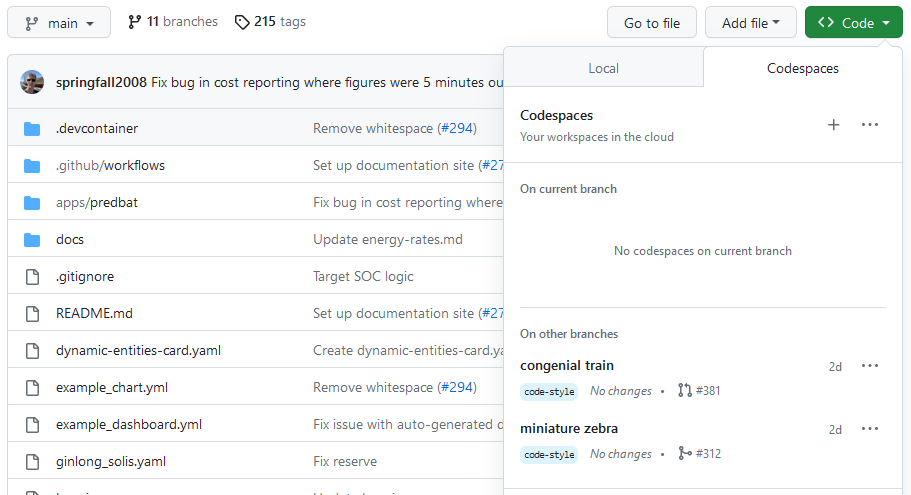

# Developing on Predbat

This guide explains how to set up a Predbat development environment, make a change on a branch,
test it, and get it merged into the core Predbat code.
It also covers the C++ prediction kernel and working on the documentation.

## The workflow at a glance

For every change you make, the steps are:

1. [Fork Predbat](#creating-a-fork) on GitHub (only needed once)
2. [Open a Codespace](#using-github-codespaces) on your fork (once - you can reuse it for every change)
3. [Add the `upstream` remote](#connecting-your-fork-to-the-main-predbat-repository) (once)
4. [Create a new branch](#creating-a-branch) for the change, starting from Predbat's `main`
5. Make the change, and [add unit tests](#adding-a-unit-test) for it
6. [Run the tests](#running-the-tests)
7. [Run the pre-commit checks](#running-the-checks-locally)
8. [Commit and push](#committing-and-pushing) the branch to your fork
9. [Raise a pull request](#raising-the-pull-request) into Predbat's `main` branch

The sections below explain each step with the exact commands to use.

## Quick reference

The whole cycle for one change, from reopening your environment to a pushed branch. Each step links to the full explanation below, and
`my-change-name` is your own branch name. Run the test and pre-commit commands from the `coverage/` directory (step 5).

| Step | Command or action |
| --- | --- |
| 1. Reopen your environment | Open [github.com/codespaces](https://github.com/codespaces) and click your Codespace. It restarts if it has stopped |
| 2. See where you are | `git status -sb` and `git branch -vv`, or look at the branch name at the bottom-left of VS Code. See [seeing which branch you are on](#seeing-which-branch-you-are-on-and-what-branches-there-are) |
| 3. Get Predbat's latest code | `git fetch upstream` |
| 4. Make a new branch | `git switch -c my-change-name upstream/main`. See [creating a branch](#creating-a-branch) |
| 5. Go to the test directory | `cd coverage`. The test scripts (`run_all`, `run_pre_commit`) set up the Python environment themselves, so the first run in a new Codespace takes longer while the packages install. You only need to activate it yourself (`source venv/bin/activate`) for `run_cov`, `run_profile`, or Python commands you run directly. See [setting up the Python environment](#setting-up-the-python-environment) |
| 6. Make the change, and its unit test | Edit in VS Code. A new test must be imported and registered in `unit_test.py`. See [adding a unit test](#adding-a-unit-test) |
| 7. Run the tests for your change | `./run_all -k keyword > /tmp/t.txt 2>&1`, then `tail -3 /tmp/t.txt` and `grep -n Traceback /tmp/t.txt`. See [running the tests](#running-the-tests) |
| 8. Run the pre-commit checks and the quick tests | `./run_pre_commit > /tmp/pre.txt 2>&1`, then `tail -5 /tmp/pre.txt`. This takes a few minutes. See [running the checks locally](#running-the-checks-locally) |
| 9. Check what will be committed | `git status`, or the Source Control view. See [check what you are about to commit](#check-what-you-are-about-to-commit) |
| 10. Commit | In the Source Control view, click `+` beside each file, type a message and click Commit. Or: `git add file1 file2`, then `git commit -m "message"` |
| 11. Push the new branch (first time only) | Source Control view: `...` menu, then Branch, then Publish Branch..., and choose `origin`. Or in the terminal: `git push -u origin my-change-name`. Don't use the Sync Changes button for the first push |
| 12. Open the pull request | Use the link that the push prints. Check that base is `springfall2008/batpred` `main`, compare is your branch, and the Commits and Files changed tabs list only your own work. First run `git log --oneline upstream/main..HEAD`, which lists the commits the PR will contain. See [raising the pull request](#raising-the-pull-request) |
| 13. Later pushes to the same branch | The Sync Changes button in the Source Control view, or `git push` |
| 14. If the pull request has conflicts | `git fetch upstream`, then `git merge upstream/main`, fix the clashes, run the tests again, then `git push`. See [if there are conflicts](#if-there-are-conflicts) |
| 15. After the pull request is merged | `git switch main`, `git pull`, `git fetch upstream`, `git merge --ff-only upstream/main`, `git push origin main`, `git branch -d my-change-name` and then `git fetch --prune`. See [after your pull request is merged](#after-your-pull-request-is-merged) |

## Setting up your development environment

### Creating a fork

Using GitHub, take a fork of Predbat - effectively, this creates
a copy of the main repository, but in your personal space.
There, you can create branches to develop on.

### Using GitHub Codespaces

#### What is GitHub Codespaces?

GitHub Codespaces gives you a full-featured development environment.

This includes:

- A full IDE (a code editor), Visual Studio Code, which can be:
    - Run in the browser, requiring no additional software to be installed
    - Run in a virtual machine (VM) running in the cloud which can connect to a copy of VS Code installed on your own machine
- A terminal where you can run commands against your codebase e.g. running `pre-commit` to run the automatic code quality checks, linting files, etc.
- Software like `mkdocs` to re-generate the documentation files (and other software we may include) pre-installed in it

The Codespaces environment is entirely separate from your HA
installation, so does not require any modification to your HA
setup to work with it.

Codespaces gives a really easy way to work on Predbat and is especially useful as you don't
need to have a running Home Assistant system to make the changes you're interested in
(e.g. for documentation, quick fixes etc.).

However, you are modifying code in an environment where you can't see HA running,
so whilst it's great for things like updating documentation, or writing automated tests, it's not
if you need to see your changes live within HA.

#### Running GitHub Codespaces

You may wish to first install [VS Code](https://code.visualstudio.com/download)
on your machine, which does offer some benefits compared to running
Codespaces in the cloud, but this is certainly not essential, and
you'll see the same code editor and terminal, and you'll have the
same commands and Python packages available in the Codespaces terminal.

Importantly, even if you do a local install of VS Code and use that
to edit your code within GitHub, the terminal, the code you're editing
any commands that you run, and any processes like `mkdocs` that you
may browse to are all running in the Codespaces VM that runs in the GitHub cloud.
Your local VS Code is connected to the Codespaces VM through SSH. It will appear as if
the code, the terminal etc. are local, but they are not. Running
a local VS Code install connected to Codespaces will not install
Python, Python packages or anything else on your local machine.

Now, from your fork or branch, click on the Code button, and select the Codespaces tab.
You can create multiple environments, or use a single environment and swap
between branches in it (the recommended approach).



Once you start your Codespaces environment, it will take a minute to
create a VM for you, and to install the software we've asked it to
install in there. It will also clone your fork of the Predbat repository and branch into
it for you, and the VM will be authenticated with GitHub
so you can commit and push straight back to your fork on GitHub.

You can choose between running the IDE in the browser or having
your local installation of VS Code connect to the environment that GitHub
Codespaces has created for you.

The Codespaces will be already set up with Python, along with various
Python packages (as defined in `requirements.txt`). The environment
is configured through the config in `.devcontainer/devcontainer.json`.

#### Working in the Codespaces terminal

Open a terminal in Codespaces by choosing Menu > Terminal > New Terminal.
All the commands in this guide are typed into that terminal.

- Codespaces usage counts against your GitHub monthly allowance of free hours and storage.
  Long running commands (the full test suite, the shuffle tests) use CPU time, and an idle
  Codespace will keep running until it times out, so it's recommended to stop it when you are not using it.
- To stop a command that is running in the terminal, press `CTRL-C` once and wait for the prompt to come back.
- If you close the terminal and open a new one, the Python virtual environment is not active any more. The test scripts
  set it up themselves each time, but see [setting up the Python environment](#setting-up-the-python-environment) for when you need to activate it yourself.

### Connecting your fork to the main Predbat repository

In git, a copy of the code on GitHub that you work with is called a *remote*.
Your fork is called `origin`. You also need to know about the main Predbat repository,
conventionally called `upstream`, so that you can start each change from the latest Predbat code.

Check which remotes you have by typing this in the terminal window:

```bash
git remote -v
```

You should see `origin` pointing at your fork (`https://github.com/<your-user>/batpred`).
If there is no `upstream`, add it once:

```bash
git remote add upstream https://github.com/springfall2008/batpred.git
```

### Developing locally within Home Assistant

The two sections below are for developing on your own computer instead of in Codespaces: running the unit tests, and trying your code against a live Home Assistant system.
Neither is part of the Codespaces route.

#### Running the unit tests on your own machine (not Codespaces)

**These steps are not part of the Codespaces route.** If you are using Codespaces, ignore this section and follow [Testing](#testing) instead.
They describe how to run the unit tests on your own computer, for example if you are developing and testing against a Home Assistant system that you run yourself:

1. Install `git` and Python 3 on your machine
2. Clone your fork of Predbat to your machine, and go into the folder:

    ```bash
    git clone https://github.com/<your-user>/batpred.git
    cd batpred
    ```

    The clone contains the whole repository, including the `coverage/` directory with its `cases/` folder of example data and a sample `apps.yaml`,
    so there is nothing to copy or extract separately. (GitHub's website can only download the whole repository as a ZIP file, not a single folder,
    which is why cloning is the easiest way to get the `coverage/` directory.)
3. Keep the folders where they are in the repository. The test scripts expect `apps/predbat` to sit alongside `coverage/`
4. Follow [running the tests](#running-the-tests): in the `coverage/` directory, run `./run_all --quick`. This sets up the Python environment the first time

#### Running your code against a live Home Assistant system (not Codespaces)

**This is not part of the Codespaces route**, as Codespaces can't see your Home Assistant system.

Three scripts in the `coverage/` directory let you try a code change with a real Home Assistant system, without having to copy files around by hand.
They are written for a Mac, with the Predbat app's configuration folder from Home Assistant mounted on the computer as a network share.

| Script | What it does |
| --- | --- |
| `deploy` | Copies your code into the Predbat app's folder on Home Assistant, so Home Assistant runs your version. It copies the `*.py`, `*.proto` and `*.so` files from `apps/predbat/`, and writes `git_version.txt` containing the short git hash of your checkout (with `-dirty` added if you have uncommitted changes). Predbat notices that its files have changed and restarts itself, so you don't need to restart the app |
| `standalone` | Runs your code on your own computer, using the app's `apps_direct.yaml` file as its configuration |
| `standalone_ha` | Runs your code on your own computer, using the app's own `apps.yaml` and `secrets.yaml` files |

The two standalone scripts work in the same way. Each creates a folder in `coverage/` (`predbat_standalone` or `predbat_standalone_ha`) containing links to the
Python files in `apps/predbat/`, so the changes you save are used the next time you start it. It then copies the configuration files into that folder
(`apps_direct.yaml` is copied as `apps.yaml`) and runs `python3 hass.py` from there, which starts Predbat.

Before you start:

- The scripts expect the Predbat app's configuration folder to be available on your computer under `/Volumes`. Home Assistant 2026.2 renamed the folder
  `addon_configs` to `app_configs`: The scripts check for `/Volumes/app_configs/6adb4f0d_predbat` first (the new pathname) and then for `/Volumes/addon_configs/6adb4f0d_predbat`. If you use another type of computer, or your folder is called something else, edit the paths in the scripts.
- `standalone` needs an `apps_direct.yaml` file in that folder. What it needs to contain (over and above a standard `apps.yaml`) is not documented here yet.
- The standalone scripts don't set up the Python environment, so first run `source setup.csh` in the `coverage/` directory (see
  [setting up the Python environment](#setting-up-the-python-environment)).
- Stop the Predbat app in Home Assistant while you test with one of the standalone scripts, as two copies of Predbat controlling the same inverter will conflict.
  The code you are testing can also send real commands to your inverter, so consider putting Predbat into read-only mode first (see the Predbat documentation).

To run a standalone script, and then press `CTRL-C` to stop it:

```bash
cd coverage
source setup.csh
./standalone
```

Use `./standalone_ha` instead to run with the app's own `apps.yaml` and `secrets.yaml`. Both standalone scripts delete any old `predbat.log` from the `coverage` directory (the log file that the unit tests writes as it runs) before they start.
The scripts then create and cd to a `predbat_standalone` (or `predbat_standalone_ha`) sub-directory, and run `python3 hass.py` from there. `hass.py` will open `predbat.log` in that sub-directory, so the standalone run log is `coverage/standalone/predbat.log`.

To copy your code into the app instead, run `./deploy`, which doesn't need the Python environment. Predbat restarts itself when it sees the new files.

`predbat_standalone/apps.yaml` is a copy of your live configuration and `predbat_standalone_ha/secrets.yaml` is a copy of your secrets, which may include passwords and access tokens.
Never commit them, delete the folders when you have finished, and check [what you are about to commit](#check-what-you-are-about-to-commit) before every commit.

## Working with branches and pull requests

### Ground rules

- **Never commit changes directly to your `main` branch.** Always make a branch for a change.
  Anything you commit to `main` and push will join any pull request that was raised from `main`.
- **One branch per change, one pull request per branch.** Small, focused pull requests are easier to
  review and merge, and independent changes can't hold each other up.
- **Start each branch from Predbat's `main`** (`upstream/main`), not from another branch of yours,
  unless the new change really does depend on the earlier one.

### Before you start: check that nobody else is on it

Two people can easily fix the same issue without knowing, and the second pull request then has to be thrown away or reworked. A couple of minutes of checking helps:

- Open the issue and read it all: the assignee, the comments, and any linked pull requests (listed on the right-hand side).
- Search the Pull requests tab of `springfall2008/batpred` for the issue number (include closed and merged ones, as the fix may have just landed).
- **Say that you are starting.** Add a comment on the issue, such as "I'm working on this on a branch in my fork", as an assignee isn't always noticed by other contributors.
- Fetch Predbat's latest code regularly while you work (`git fetch upstream`) and look at what has changed in the files you are editing, so that you spot overlapping work early, before you have invested much in it.

If it turns out that someone has already made the same change, review their pull request, and offer anything that is missing as a separate follow-up (agree it on the issue first).

### Creating a branch

Before you start, make sure that you have no uncommitted work (`git status --short` should print nothing),
or commit or stash it first. Then:

```bash
git fetch upstream
git switch -c my-change-name upstream/main
```

This creates a new branch called `my-change-name` which contains Predbat's latest code and none of your other work.
Choose a short descriptive branch name, using lower case letters and hyphens (for example `fix-rate-rounding`).
Git confirms what it has done:

```text
$ git switch -c discharge-target-soc upstream/main
branch 'discharge-target-soc' set up to track 'upstream/main'.
Switched to a new branch 'discharge-target-soc'
```

The "set up to track 'upstream/main'" line means that the new branch follows Predbat's repository, not your fork.
That is why the first push of a new branch is done with `git push -u origin my-change-name`, which points it at your fork instead
(see [committing and pushing](#committing-and-pushing)).

Check the starting point is what you expect:

```bash
git log --oneline -3
git status -sb
```

The output should look like this (the commits will be whatever Predbat's latest ones are when you run it):

```text
$ git log --oneline -3
cca8967f7 (HEAD -> discharge-target-soc, tag: v9.4.6, upstream/main) fix(plan): only split charge windows at dawn, not at the midnight light/dark reset (#5709)
e4068d6f6 Update predbat.py
333c358c8 refactor: drop dead timezone fallbacks after strptime_aware in octopus.py and solcast.py (#5695) (#5696)

$ git status -sb
## discharge-target-soc...upstream/main
```

What to look for:

- On the first line of the log, `HEAD -> your-branch-name` and `upstream/main` are on the same commit, so your branch starts exactly at Predbat's latest code.
  (The tag, here `v9.4.6`, shows the Predbat version.)
- The log contains none of your own earlier commits.
- `git status -sb` shows your branch following `upstream/main`, with no changed files listed below it.

A stricter check is to ask git for the commits that your branch has and Predbat's `main` doesn't. Straight after creating a branch there should be none, so this prints nothing:

```bash
git log --oneline upstream/main..HEAD
```

If the log shows commits from one of your earlier changes, or that command lists anything, you started from the wrong place - switch back and recreate the branch using the commands above.

**A new branch starts from wherever you are, unless you say otherwise.** `git switch -c my-change-name` on its own makes the branch from the branch that is currently checked out, so if you
were on your own `main` the new branch contains all of its commits. The `upstream/main` on the end of the command is what makes it start from Predbat's code.
The same applies in VS Code: choose **Create new branch from...** (from the branch name in the bottom-left status bar), and pick `upstream/main` as the starting point when it asks,
as a plain "Create new branch" starts from the current branch.

### Seeing which branch you are on, and what branches there are

- **Which branch you are on:** the name is shown at the bottom-left of the VS Code window (the status bar), and the terminal prompt shows it in brackets,
  for example `(discharge-target-soc)`.
- **The list of branches, in VS Code:** click the branch name at the bottom-left. A list opens at the top of the window showing your local branches,
  and below them the branches on GitHub (such as `origin/main`, and `upstream/main` for Predbat's own). Choosing one switches to it, so commit or
  [stash](#working-on-more-than-one-change-at-once) your changes first.
- **The list of branches, in the terminal:**

    ```bash
    git branch -vv
    git branch -r
    ```

    `git branch -vv` lists your local branches with their latest commit and the branch each one follows. `git branch -r` lists the branches on GitHub,
    as they were the last time you ran `git fetch`. Run `git fetch --all` first to bring that list up to date, and use `git branch -a` to see both lists together.

Branches that begin `origin/` are on your fork, and branches that begin `upstream/` are on Predbat's main repository. A branch with no `origin/` or `upstream/` is a local one.

### Working on more than one change at once

Each change lives on its own branch, so you can have several in flight at the same time.
Commit your work on one branch before moving to another, then switch between them with:

```bash
git switch other-branch-name
git branch -vv
```

(`git branch -vv` lists your branches and what they are tracking.)
If the changes don't touch the same files, the pull requests can be merged in any order.

**Uncommitted changes are not tied to a branch.** When you run `git switch`, any changes you haven't committed come with you to the other branch
(unless they clash with it). So if you edit files on one branch, switch to `main` and run the tests, you are testing `main` *plus your edits*, which is
not what you intended. Either commit your work first (a commit with a message like "WIP" is fine - you can tidy it up before the pull request),
or set the changes aside until later:

```bash
git stash push -u -m "describe the work"
git switch other-branch-name
# ... do something on the other branch ...
git switch my-change-name
git stash pop
```

`git status` shows whether you have uncommitted changes, and `git stash list` shows anything that is set aside.

### Committing and pushing

Run the [tests](#testing) and the [pre-commit checks](#running-the-checks-locally) first.

#### Check what you are about to commit

Before you commit, check that the commit will only contain the files you meant to change. In the terminal, type:

```bash
git status
```

The output lists your files in groups:

- **Changes to be committed** - files that are staged, so will be in the commit
- **Changes not staged for commit** - files you have modified but not staged, so they won't be in the commit
- **Untracked files** - new files that git doesn't know about. They are only included in a commit if you stage them

Compare the list with the files you expect to have changed. The Source Control view in Codespaces shows the same list
(modified files are marked `M` and new files `U`).

If there is something there that shouldn't be:

| Situation | What to do |
| --- | --- |
| A file is staged but doesn't belong in this commit, and you want to keep the file | `git restore --staged path/to/file` (in the Source Control view, click the `-` beside it) |
| A new file that you don't want, such as a results file or a copy of a config file made while testing | Don't stage it and it won't be committed. To get rid of it, delete the file (`rm path/to/file`) - this can't be undone |
| An existing file that you changed by accident | `git restore path/to/file` puts it back as it was at the last commit, **throwing away your changes to it** - this can't be undone |
| You already committed it, but haven't pushed yet | `git reset HEAD~1` undoes the last commit but leaves your files as they are, so you can stage the right files and commit again |
| You already pushed it | Remove it in a new commit (`git rm --cached path/to/file` keeps the file on your machine but takes it out of the repository), then commit and push. If you aren't sure, ask in the PR |

If a file you pushed contained a password or an API key (for example a copy of `secrets.yaml`), treat that secret as exposed and change it,
and ask a maintainer for help removing it from the history.

Run `git status` again afterwards to confirm that it now shows what you expect.

#### Committing

You can commit and push either with the Source Control view in Codespaces, or with commands in the terminal.
The result is the same, so use whichever you prefer.

#### Using the Source Control view in Codespaces

1. Open the Source Control view (in the toolbar down the left-hand side, third from the top).
   It lists every file you have changed.
2. Stage the files that belong in this change by clicking the `+` beside each one. Check that the list only contains files you meant to change -
   results files, or copies of config files that you made while testing, should not be committed.
3. Type a commit message, and click Commit. Mention any related GitHub issues in the message using `#1234`.
   (If nothing is staged, VS Code offers to stage *all* your changes and commit them. That includes any stray files, so check the list first.)
4. Push the commit to your fork. For the **first** push of a new branch, use the Publish Branch menu: click the three dots (`...`) at the top of the Source Control view,
   choose **Branch**, then **Publish Branch...**. VS Code asks "Pick a remote to publish the branch to". It lists `origin` (your fork, at `https://github.com/<your-user>/batpred`)
   and `upstream` (Predbat's repository). Choose **`origin`**. This pushes the branch and makes it follow your fork, the same as the terminal command:

    ```bash
    git push -u origin my-change-name
    ```

    **Don't use the Sync Changes button for the first push.** A branch created with `git switch -c my-change-name upstream/main` will follow Predbat's repository (`upstream/main`),
    so the button appears as Sync Changes (not Publish Branch), and clicking it tries to push to Predbat's repository. VS Code then says "You don't have permissions to push to
    springfall2008/batpred" and offers to **Create Fork**. If you see that message, choose Cancel (or No). Nothing has been pushed, and the branch is fine.

    To check where the branch went, run `git branch -vv`. It should show `[origin/my-change-name]` beside your branch, like this:

    ```text
    * my-change-name   8afe508e [origin/my-change-name] docs: restructure the development guide
    ```

    After the first push, Sync Changes is safe to use. The exact menu and button labels vary a little between versions of VS Code.

#### Using the terminal

```bash
git add path/to/changed_file.py path/to/new_test.py
git commit -m "A short summary of the change"
git push -u origin my-change-name
```

Add files by name rather than using `git add .`, so that stray files (for example, results files or
copies of config files that you created while testing) don't end up in your commit.
`git status --short` shows what is changed and what is staged.

If you have run `pre-commit install` (see [running the checks locally](#running-the-checks-locally)) the checks also run automatically
whenever you commit, whichever route you use.

After you push, GitHub normally offers a "Compare & pull request" button on your fork's page.

The first push of a new branch prints something like this:

```text
$ git push -u origin discharge-target-soc
...
remote: Create a pull request for 'discharge-target-soc' on GitHub by visiting:
remote:      https://github.com/<your-user>/batpred/pull/new/discharge-target-soc
...
 * [new branch]        discharge-target-soc -> discharge-target-soc
branch 'discharge-target-soc' set up to track 'origin/discharge-target-soc'.
```

The link opens the pull request page for the branch. The last line shows that the branch now follows your fork instead of Predbat's repository,
so from now on the Sync Changes button in the Source Control view works for it.

#### Check which commits the pull request will contain

A pull request contains every commit on your branch that Predbat's `main` doesn't have. If the branch was started from the wrong place (for example from your own `main`,
which has other work on it), all of that other work comes along and is reviewed as part of the pull request. Check this before you push:

```bash
git log --oneline upstream/main..HEAD
```

This lists exactly the commits that the pull request will contain. It should show only the commit or commits you made for this change.
If it shows others, don't push. Create a new branch from `upstream/main` (see [creating a branch](#creating-a-branch)), then bring your changes across, either by copying the changed files
into the new branch or with `git checkout my-old-branch -- path/to/file`, and commit them there.

### Raising the pull request

Open a pull request (PR) from your branch (on your fork) into the `main` branch of `springfall2008/batpred`.
A pull request has two sides, and it is worth checking both before you submit it:

- **Base** - where your change is going to: the `main` branch of the **`springfall2008/batpred`** repository
- **Compare** (the head) - where your change is coming from: **your branch**, on your fork

The compare side must be the branch that you made for this change, not `main`.

The easiest way to raise one:

1. Push your branch to your fork (see [committing and pushing](#committing-and-pushing)).
2. Open your fork on GitHub (`https://github.com/<your-user>/batpred`). It normally shows a banner saying that your branch had recent pushes,
   with a **Compare & pull request** button. Click it.
3. On the page that opens, check the line at the top. It should read like this:

    ```text
    base repository: springfall2008/batpred   base: main   <-   head repository: <your-user>/batpred   compare: my-change-name
    ```

    If it doesn't, use the drop-down boxes to change them. In particular, make sure that the base repository is `springfall2008/batpred`
    (not your fork) and that "compare" is your branch (not `main`).
4. Fill in the title and the description (see below). You can choose **Create draft pull request** if you want early feedback before it is ready to merge.
5. Before you submit, open the **Commits** and **Files changed** tabs and check that they only list your own commits and the files that you meant to change. If they show
   other work - for example another change of yours - the branch was started from the wrong place.

VS Code may also offer to create the pull request when you publish the branch. You can use that, but the page on GitHub makes it easier to check the base and compare branches.

If you don't see the banner, go to your fork's page, use the branch drop-down to select your branch, then click Contribute and Open pull request.
Alternatively, go to the Pull requests tab of `springfall2008/batpred`, click New pull request, then "compare across forks" and choose
your fork and your branch.

The PR should describe the work you've done in a way that
makes it easy for someone to review your work, and either
add comments or approve it. A good description covers:

- What the change does and why it is needed
- What is deliberately **not** changed, if a reviewer could reasonably expect it to be
  (for example, an entity that is intentionally left hard coded) - say why, and ideally also add a comment in the code
- How you tested it - which tests you added, and that the full test suite and the pre-commit checks passed
- Anything that is already failing on `main` and isn't caused by your change
- The GitHub issues that the PR addresses - writing `Fixes #1234` in the description links the PR to issue 1234, and closes the issue when the PR is merged

Once the PR is open:

- Automatic checks are run on every push to the branch (see
  [running the checks from within GitHub](#running-the-checks-from-within-github)). If the automatic checks fail they may auto-correct simple formatting issues (such as removing trailing white space) and will add a commit to your branch. You will need to run `git pull` before you push again.
- Reviewers may add comments or ask for changes. Make the changes on the same branch and push them - the PR updates automatically.

### Keeping your branch up to date

Your branch started from a snapshot of Predbat's `main`. While your pull request is open, other people's changes are merged into `main`,
so your branch falls behind. GitHub shows a message on the PR when this happens, such as "This branch is out-of-date with the base branch"
or "This branch has conflicts that must be resolved".

You only need to bring your branch up to date if GitHub reports **conflicts** (the same lines of a file changed in both places),
or if you want the latest Predbat code in your testing. To do it:

```bash
git fetch upstream
git merge upstream/main
git push
```

Then run the tests again.

#### What does merge do?

`git merge upstream/main` copies Predbat's newer commits into your branch, and adds one extra commit (a "merge commit") that joins
the two lines of history together. Nothing that already exists is changed, so it is safe, and the `git push` is an ordinary push.
This is the recommended way.

#### What does rebase do, and why is it not recommended?

`git rebase upstream/main` does the same job differently. It lifts your commits off your branch, brings the branch up to the latest `main`,
and then replays your commits on top, so the history looks like one straight line.
The catch is that each replayed commit is a brand-new commit, so your branch no longer matches the copy on GitHub and a normal `git push`
is refused. You must force the push, which replaces the branch on GitHub with your local version.

#### What does `--force-with-lease` do?

If you do rebase, push with `git push --force-with-lease`. A plain forced push (`--force`) overwrites the branch on GitHub
no matter what is there. `--force-with-lease` only overwrites it if the branch on GitHub is still exactly as you last saw it, and refuses otherwise.
That matters because other things can add commits to your branch without you knowing - the automatic pre-commit checks do this
(see [running the checks from within GitHub](#running-the-checks-from-within-github)), and so might a reviewer.
A plain force push would silently delete those commits; `--force-with-lease` stops and tells you to fetch them first.
Unless a maintainer asks you to rebase, stick with merge.

#### If there are conflicts

A conflict means that you and someone else changed the same lines of a file, so git can't decide which to keep.
Before you have opened the pull request, the page for opening it shows "Can't automatically merge" (you can still open it).
Once it is open, GitHub shows "This branch has conflicts that must be resolved", and the pull request can't be merged until you fix them.
It is tidier to fix conflicts before opening the pull request, so that it starts clean.
Resolve them in Codespaces, so that you can run the tests afterwards:

1. Check that you have no uncommitted changes (the Source Control view should be empty), then bring Predbat's latest code into your branch in the terminal:

    ```bash
    git fetch upstream
    git merge upstream/main
    ```

2. If git reports conflicts, the Source Control view shows a **Merge Changes** section listing the files that clash. Open each one.
3. Each clash is marked in the file between `<<<<<<<` and `>>>>>>>` lines, with `=======` dividing the two versions. VS Code shows buttons above each clash:
    - **Accept Current Change** keeps *your* version (the branch you are on)
    - **Accept Incoming Change** keeps *Predbat's* version (from `upstream/main`)
    - **Accept Both Changes** keeps both, one after the other
    - **Compare Changes** shows the two versions side by side

    Often both sets of changes need to be kept, so read each clash carefully. You can also edit the text directly, then delete the marker lines.
    VS Code also offers a three-way Merge Editor (a button at the bottom right of the file).
4. When every file is done, stage each fixed file (the `+` beside it in the Merge Changes section) and commit. The commit message is already filled in ("Merge remote-tracking branch 'upstream/main' ...").
5. Run the tests again, because the merged code is new code, then push:

    ```bash
    git push
    ```

The pull request updates by itself, and the conflict message goes away.

If you get stuck, `git merge --abort` puts your branch back exactly as it was before the merge. If you aren't sure how to resolve a clash,
ask on the pull request and paste the clash (the text between the `<<<<<<<` and `>>>>>>>` lines).

### After your pull request is merged

Bring your `main` up to date with Predbat's `main`. This works as long as you've followed the ground rules and made
no commits of your own on `main`:

```bash
git switch main
git pull
git fetch upstream
git merge --ff-only upstream/main
git push origin main
```

Why each step is there:

- `git fetch upstream` only *downloads* Predbat's latest commits. It updates `upstream/main` (your copy of Predbat's branch) but never
  changes your own branches, so your `main` looks the same until you merge.
- `git pull` brings your local `main` up to date with your fork on GitHub. If git says "Your branch is behind 'origin/main' by N commits, and can be fast-forwarded",
  your fork has moved ahead (for example after using Sync fork on GitHub) and this step catches up.
- `git merge --ff-only upstream/main` then adds Predbat's newer commits. If it says "Not possible to fast-forward", your `main` contains commits that Predbat's doesn't:
  look at them with `git log upstream/main..main --oneline` and work out why before going further.
- `git push origin main` updates your fork on GitHub.

If `git merge --ff-only` says it can't fast-forward because your `main` has commits of its own, you are probably in the situation that the ground rules are meant to avoid: you made
a pull request from `main`. In that case `main` is the branch of that pull request, so **leave it alone** until the pull request has been merged, and don't reset it or force push it.
It doesn't stop you doing anything else, because new work starts from `upstream/main` (see [creating a branch](#creating-a-branch)), not from your `main`. If you want your `main`
brought up to date with Predbat while the pull request is open, use `git merge upstream/main` (without `--ff-only`), resolve any conflicts and push, as in
[keeping your branch up to date](#keeping-your-branch-up-to-date).

An alternative that doesn't use the terminal is the **Sync fork** button on your fork's page on GitHub, followed by `git pull` in your `main` branch.

To confirm that your change has been merged, look at the history of a file you changed in Predbat's branch. Do this first, as your own `main` doesn't have the change until you update it:

```bash
git fetch upstream
git log upstream/main --oneline -3 -- apps/predbat/givtcp.py
```

Your pull request should be at or near the top of the list. The names in brackets after a commit's hash (such as `origin/my-change-name, my-change-name`) are the branches that currently point at that commit.

Then delete the finished branch. The **Delete branch** button on the merged pull request removes it from your fork on GitHub, and `git branch -d my-change-name` removes your local copy.
If git refuses with "not fully merged", it is because the pull request was merged as a single new commit, so git can't see that your commits are in `main`.
Check that the pull request shows as merged, then use `git branch -D my-change-name`.

Deleting the branch on GitHub doesn't remove your Codespace's record of it (`origin/my-change-name`). Tidy that too with `git fetch --prune`, after which `git branch -r` no longer lists it. To delete the branch on your fork from the terminal instead of using the button, run `git push origin --delete my-change-name`.

You can then start the next change from [creating a branch](#creating-a-branch).

## Code layout

A few pointers for finding your way around the Predbat repository.

- All code lives in `apps/predbat/`:

| File | What it does |
| --- | --- |
| `predbat.py` | The main `PredBat` class, built from several mixin classes (`Fetch`, `Plan`, `Execute`, `Output`, `UserInterface`, etc.). The main loop (`update_pred()`) runs every 5 minutes: fetch data, run the optimisation, execute the plan, publish results |
| `config.py` | `CONFIG_ITEMS` (every user configurable setting, published as Home Assistant entities) and `APPS_SCHEMA` (validation of `apps.yaml`) |
| `fetch.py` | Gets rates, solar forecasts, historical load and inverter state |
| `plan.py` | The optimisation engine - searches charge/discharge window scenarios |
| `execute.py` | Sends the resulting commands to the inverter |
| `output.py` | Creates and updates the Home Assistant sensors that show the plan and metrics |
| `userinterface.py` | Manages the Home Assistant input entities (switches, selects, numbers) |
| `components.py`, `component_base.py` | The plugin system. Each integration (Octopus, Solcast, inverter clouds etc.) is a component |

Some things that are worth knowing before you start:

- Because `PredBat` is built from mixin classes, they all share one `self`. Values that several of them need (for example
  `self.currency_symbols`) are set in `PredBat.reset()`. Components and other standalone classes don't inherit from `PredBat` -
  they reach it through `self.base`, or through properties that `ComponentBase` exposes (and that the test `MockBase` must then also provide).
- To add or change a user setting, edit `CONFIG_ITEMS` in `config.py`. Items can be conditional on other settings
  (the `enable` field) and are only published to Home Assistant when enabled.
- Use the Storage component for saving and loading cached data, rather than accessing files directly.

- All documentation lives in the `docs` folder, in Markdown format

- The `templates` folder contains all the `apps.yaml` templates for different inverter types. Each template should be self-contained so new users can simply copy that template in and configure to their environment.

- `apps/predbat/tests` - contains all the test scripts for Predbat.

- `coverage` - scripts to manage the testing process

- `.cspell/custom-dictionary-workspace.txt` - the custom dictionary file for Predbat. If you add new words to the documentation or code that the spelling checker does not recognise then you need to add them to this file otherwise the pre-commit tests will fail.

## Testing

Predbat has a unit test suite in `apps/predbat/tests/`. **Unit tests must be added for all new code.**

All the test commands are run from the `coverage/` directory in the repository. The scripts in it use paths that are relative to
that directory, such as `../apps/predbat` for the code and `../requirements.txt` for the Python packages, and the tests find
their configuration files (for example `apps.yaml`) there too.
You don't need to copy any files anywhere, and you don't need a Home Assistant system - the tests run against a mock of it.

### Setting up the Python environment

The `./run_all`, `./run_pre_commit`, `./run_random`, `./run_random_profile` and `./run_shuffle` scripts set up the Python environment themselves. Each time they run, they run `source setup.csh`, which
creates a virtual environment in `coverage/venv` if there isn't one, and installs the packages in `requirements.txt` into it.
So the first run takes a little longer, and you don't need to do anything by hand before running them.

The environment is only active while one of these scripts runs - it isn't left switched on in your terminal.
The other scripts (`run_cov`, `run_profile`, `standalone`, `standalone_ha` and the Python helper scripts) don't set it up, so activate it yourself first.
You also need to activate it when you run Python commands directly, for example the commands in [random-scenarios.md](random-scenarios.md):

```bash
cd coverage
source setup.csh
```

Afterwards the terminal prompt starts with `(venv)`. In a new terminal, once the environment exists, you can just re-activate it:

```bash
cd coverage
source venv/bin/activate
```

### Running the tests

| Command | What it does |
| --- | --- |
| `./run_all` | Runs all the tests |
| `./run_all --quick` | Skips the slow tests. This is what the GitHub checks run, so it's the one to use before a PR |
| `./run_all --list` | Lists all the test names, and which are marked slow |
| `./run_all --test basic_rates` | Runs one test, by name |
| `./run_all --test basic_rates --test units` | Runs several named tests |
| `./run_all -k octopus_` | Runs every test whose name contains the keyword |
| `./run_all --shuffle` | Runs the tests in a random order (see [finding test order dependencies](#finding-test-order-dependencies)) |

The tests take a while to run, so **always send the output to a file, then search the file afterwards**.
If you pipe the output straight into `grep` and search for the wrong thing, you have to run everything again!

For example, running all the test scripts, putting the script output into a file, checking the end of the file that all tests were run, and then checking for any test failure messages:

```bash
./run_all --quick > /tmp/all_tests.txt 2>&1
tail -3 /tmp/all_tests.txt
grep -n "FAILED\|Traceback\|AssertionError" /tmp/all_tests.txt
```

### Reading the results

- A successful run finishes with a line like `**** All tests passed (4 slow tests skipped, total time: 211.29s) ****`.
- A failing test that raises an exception will stop with a traceback (often an `AssertionError`, with a message saying what was expected),
  and the run does not end with the "All tests passed" line.
- Tests can also fail by printing an `ERROR:` line and returning True but no traceback. The unit_test handler will print `**** <name>: FAILED in ...s` (or `**** ERROR: Test <name> FAILED with --test/-k`), followed by `**** ERROR: Some tests failed` at the end of the output.
- Be aware that the test output is long and **contains many `Error:` and `Warn:` log lines even in a passing run**. Many tests
  deliberately feed in bad data (for example corrupt update files or invalid configuration) to prove that Predbat rejects it
  and reports it correctly. Searching for the word "error" will find these, so it is not a good way to look for failures.
  Search for `Traceback` and `AssertionError`, and check the last line instead.
- To see which test a log line belongs to, look back for the nearest preceding line starting with `**** Running:`.
- Predbat's own log for the run is written to `predbat.log` in the `coverage/` directory, and `./run_all` deletes the previous one first.
  When a test fails, this file shows what Predbat was doing, in the same format as its normal log.

### Adding a unit test

1. Create `apps/predbat/tests/test_<feature>.py`. Each test is a function that takes `my_predbat` (a fresh `PredBat` instance, built for that test by `create_predbat()`).
   The function must have a docstring (docstring coverage is enforced). It returns `False` if the test passed and `True` if it failed.
   Tests either use `assert` statements with a helpful message, or print an `ERROR:` line and return `True`.
2. In `apps/predbat/unit_test.py`, import your test function(s), next to the existing imports of the other tests:

    ```python
    from tests.test_my_feature import test_my_feature
    ```

3. Still in `unit_test.py`, register the test in the `TEST_REGISTRY` list in `main()`. Each entry is
   `(name, function, description, slow)`. Set `slow` to `True` only for tests that take a long time, as they are skipped by `--quick`:

    ```python
    ("my_feature", test_my_feature, "Description of what is tested", False),
    ```

4. Check that it has been registered, and run it:

    ```bash
    ./run_all --list | grep my_feature
    ./run_all --test my_feature
    ```

**A common mistake is to write the test function but not import and register it in unit_test.py** (or to register only some of several test functions
in a file). It is then never run, so can't fail. Use `./run_all --list` to check that every test function you have written appears.

Tips for writing good tests:

- Copy the structure of a small, existing test in `apps/predbat/tests/` that is similar to what you want to test.
- Test the behaviour, not just that the code runs. Include the cases where nothing should change as well as the case where something should.
- Each test gets its own `PredBat`, so you can change settings and attributes on `my_predbat` freely: the changes don't reach other tests.
  State that is *not* rebuilt for each test is different - module-level variables, class attributes, and anything you monkey patch. If a test changes one of those,
  restore it afterwards, using `try`/`finally` so that it is restored even if the test fails (see [finding test order dependencies](#finding-test-order-dependencies)).
- Some config items are only published to Home Assistant when another setting is on (for example `expert_mode`).
  If a test reads an entity that isn't there, check for an `enable` condition on the item in `config.py`.
- The test messages and comments are spell checked like the rest of the code (see [enforced standards](#enforced-standards)).

### Finding test order dependencies

Each test builds its own `PredBat` with `create_predbat()` (see `unit_test.py`), so changes to the attributes of that instance can't leak into other tests. What can still leak is module-level or class-level state that `create_predbat()` doesn't rebuild - for example the `PLOT_ENABLED` module variable in `tests/test_infra.py`, or something that a test monkey patches and doesn't undo. A test that changes state like this and doesn't fully restore it can make a *later* test fail - a bug in the test suite itself, not in Predbat (see issue [#5079](https://github.com/springfall2008/batpred/issues/5079)). These only show up when the two tests happen to run in that order, so a clean `./run_all` doesn't prove there isn't one lurking.

`./run_shuffle` fuzzes the test order looking for these:

- `./run_shuffle --hunt --quick` - one-liner: keep trying shuffled orderings until a failure is found, narrow it down to the minimal pair of tests that reproduces it, print that repro command, and record the pair in `tools/shuffle_fuzz_known_pairs.txt` so the next run looks for a *different* one instead of rediscovering the same pair. This is the normal way to run it.
- `./run_all --shuffle [--shuffle-seed N]` - run the full suite (or whatever `--test`/`-k` selects) in a random order directly, without the fuzzing wrapper. Useful for a one-off check or replaying a specific `--shuffle-seed` a `--hunt` run reported.
- `./run_shuffle --bisect <SHUFFLE_SEED>` - given a shuffle-seed that's known to fail, narrow down which earlier test caused it, without hunting for a new one.
- `./run_shuffle --campaign N` - repeat hunt-and-bisect for `N` independent rounds and print a frequency table of which (culprit, victim) pairs recur, to tell a common leak apart from a one-off ordering artefact.

A found pair only proves that state leaked from one test to another - it doesn't say by itself whether the fix belongs in the culprit test's cleanup, or whether it exposed a real gap in the production code the victim test exercises (e.g. a missing bounds check that would also matter outside of tests). Check both before assuming it's "just" a test hygiene issue.

This is too slow for a per-commit CI gate (each hunt attempt is a full shuffled suite run, and a failure needs a further round of bisection on top), but cheap to run periodically or before a release.

### Replaying a debug dump

When `switch.predbat_debug_enable` is on, Predbat writes a full state dump called `predbat_debug_*.yaml` to the `debug/` folder.
These are normally attached to bug reports. You can replay one against the code you are working on:

```bash
cd coverage
./run_all --debug_file <path-to-predbat_debug.yaml>
```

It lists every config item that differs from its default, recalculates the plan, and writes `plan_orig.html` and
`plan_final.json` into `coverage/`. Add `--redo` to recompute the rates, load model and Octopus slots instead of reusing the ones in the dump.

Example dumps are kept in `coverage/cases/*.yaml`, and they are replayed as regression tests by `./run_all --test debug_cases`.
The dumps are recorded data: the saved settings are loaded back in, but not the display attributes of config items (such as their icons).
There is no need to update them when you change how entities are presented.

### Random scenario benchmarking

Predbat can generate reproducible random scenarios, run them through the optimiser, and compare two runs. This is useful to check that a change to the optimiser
improves results (or, for a change that shouldn't affect the plan, that nothing has changed) and to compare run times.
See [random-scenarios.md](random-scenarios.md) for the details.

### Failure plots, profiling and coverage

When a model scenario fails, a plot of its SoC and metric is written to `<scenario_name>.png` in the working directory. Add `--plot` to also open that plot on screen. It's off by default because displaying it blocks until you close the window, which would stall an unattended or CI run - a failing test would look like a hang rather than reporting the failure.

`./run_profile cases/<name>.yaml -s time -n 50` profiles the planning of one of the debug dumps, to find slow functions (see [the scripts and files in the coverage directory](#the-scripts-and-files-in-the-coverage-directory) for the options).

For coverage analysis install the 'coverage' library with Python, or use the version installed from `requirements.txt`.

1. `./run_cov --quick`
2. Open `htmlcov/index.html` in your web browser

### The scripts and files in the coverage directory

Everything here is run from the `coverage/` directory. Scripts that don't set up the Python environment themselves are marked with an asterisk (\*) - activate the environment first (see
[setting up the Python environment](#setting-up-the-python-environment)).

#### Running the tests and checks

| Script | What it does |
| --- | --- |
| `run_all` | Sets up the Python environment, removes any old `predbat.log` (the log file that Predbat writes as it runs), then runs `../apps/predbat/unit_test.py`, passing on any options you give it. See [running the tests](#running-the-tests) |
| `run_pre_commit` | Sets up the environment, runs the pre-commit checks on all files, then the quick tests. See [running the checks locally](#running-the-checks-locally) |
| `run_cov` \* | Runs `unit_test.py` under coverage analysis (passing on options such as `--quick`), then writes an HTML report to `htmlcov/`, leaving out the tests themselves |
| `run_shuffle` | Sets up the environment, then runs `../tools/shuffle_fuzz.py` with your options. See [finding test order dependencies](#finding-test-order-dependencies) |
| `setup.csh` | Creates the virtual environment in `coverage/venv` and installs `../requirements.txt` into it. Run by the scripts above, or by hand |
| `setup.cfg` | Settings for the coverage analysis (it leaves out the installed packages in `site-packages`) |

#### Profiling and benchmarking

| Script | What it does |
| --- | --- |
| `run_profile` \* | Profiles the planning of one debug dump: `./run_profile cases/predbat_debug_agile1.yaml`. With no arguments it lists the `cases/predbat_debug_*.yaml` files. Options: `-v` (or `--view`) opens the result in snakeviz (`pip install snakeviz`), `-s` chooses the sort order (`cumulative`, `time`, `calls` or `ncalls`), `-n` sets how many functions to show, and `-o` chooses the output file |
| `profile_debug.py` \* | The Python script behind `run_profile`. It runs `unit_test.py --debug_file` under cProfile, saves `<name>_profile.prof`, and prints the slowest functions |
| `run_random` | Sets up the environment, runs the scenarios in `cases/random_scenarios.yaml` (using `agile1` as the template), writes `random_results.json`, and compares it with the stored `cases/random_results.json`. See [random-scenarios.md](random-scenarios.md) |
| `run_random_profile` | Sets up the environment, profiles random scenario 0 sorted by time within each function, and saves the top 500 functions in `profile_cprofile.log` |

#### Running against Home Assistant

| Script | What it does |
| --- | --- |
| `standalone` \*, `standalone_ha` \*, `deploy` | See [running your code against a live Home Assistant system](#running-your-code-against-a-live-home-assistant-system-not-codespaces) |
| `setup_git` | A personal helper for the project maintainer's Mac: it starts `ssh-agent`, loads an SSH key from `~/.ssh/id_ed25519`, and sets the `origin` remote to `git@github.com:springfall2008/batpred.git`. **Don't run it** - it would point your `origin` at the main Predbat repository instead of your fork |

#### Load predictor helper scripts

| Script | What it does |
| --- | --- |
| `analyze_data.py` \*, `analyze_periods.py` \* | Print statistics about the load history (the energy used in each 5 minute step, and for the recent and training periods) |
| `debug_model.py` \*, `debug_predict.py` \* | Train the machine learning load predictor (`LoadPredictor`, in `apps/predbat/load_predictor.py`) on the load history, and show what the model has learned and what it predicts. `debug_predict.py --quick` only prints summary statistics |
| `dev_tests/test_process_load_power.py` | A manual developer script that runs `load_power_data.yaml` through the `fill_load_from_power` code and plots the result. It is not part of the unit test suite |

These are development tools for investigating the load predictor, and aren't run by the unit tests. They read a `load_minutes_debug.json` file from the `coverage/` directory
(and `dev_tests` needs a `load_power_data.yaml`). Neither file is in the repository, and where they come from isn't documented here yet.

#### Configuration and test data

| File | What it is |
| --- | --- |
| `apps.yaml` | The Predbat configuration that the unit tests load. Changing it can change the test results |
| `cases/` | Test data. The `predbat_debug_*.yaml` files are debug dumps, each with a matching `.expected.json` holding the expected result, and are replayed by `./run_all --test debug_cases`. `random_scenarios.yaml` and `random_results.json` are the scenarios and the stored results used by `run_random`. The other files (`annual_reference_*.json`, `ml_history_fixture.json.gz`, `rest_v2.json` and `rest_v3.json`) are reference data used by individual tests |

#### Files that the scripts create

Running the scripts creates files and folders in `coverage/`, such as `venv/`, `htmlcov/`, `predbat.log`, `predbat_standalone/`, `predbat_standalone_ha/`, `*_profile.prof`,
`profile_cprofile.log`, `random_results.json`, `plan_orig.html`, `plan_final.json` and the failure plots (`*.png`). These are results, not source, so they shouldn't be committed.
Use `git status` to check (see [check what you are about to commit](#check-what-you-are-about-to-commit)).

### Troubleshooting the tests

| Symptom | Likely cause |
| --- | --- |
| `apps.yaml` or another config file is not found | You are running from the wrong directory. Run the tests from `coverage/`. Don't copy `apps.yaml` or `secrets.yaml` into other folders to make it work - if you have, delete the copies so they aren't committed by accident |
| `No secrets.yaml file found` (an `Info` message) | Normal. The tests don't need real secrets |
| `ModuleNotFoundError`, or a missing Python package, when you run a Python command directly | The virtual environment isn't active. See [setting up the Python environment](#setting-up-the-python-environment) |
| `AttributeError` on a new `self.something` in a test that builds its own mock object | Tests with their own mock `PredBat` (or `MockBase`) need to set the new attribute too |
| A test passes alone but fails in a full run (or the reverse) | Module-level or class-level state leaking between tests. Each test has its own `PredBat`, so look for globals, class attributes and monkey patches that a test changes and doesn't restore. See [finding test order dependencies](#finding-test-order-dependencies) |
| A test run seems stuck (no new output for many minutes) | Look for leftover test processes from an earlier run that was interrupted (`ps -eo pid,etime,pcpu,cmd \| grep -E "unit_test\|shuffle_fuzz\|run_all" \| grep -v grep`) and stop them with `kill <pid>`. Then press `CTRL-C` once to stop the stuck run, and run just the test it was stuck on (`./run_all --test <name>`) to see whether it hangs on its own |
| A test you wrote never shows up | It isn't imported and registered in `unit_test.py`. See [adding a unit test](#adding-a-unit-test) |
| A test fails and you aren't sure whether your change caused it | Run it on clean code and compare. Set your changes aside with `git stash push -u -m "wip"`, run the same `./run_all --test ...` command, then bring them back with `git stash pop`. If it fails without your changes too, the failure isn't yours. Make sure you aren't just testing `main` with your uncommitted edits (see [working on more than one change at once](#working-on-more-than-one-change-at-once)) |

## Coding standards

### Expected standards

This section will be enhanced following discussions as we go.

However, here's a starting point:

- Variable names should be `lower_case_with_underscores` - this fits
with most existing variables, is a common standard for Python code,
and also allows the spell checking to check individual words within
the variable name.
- Use British English spelling (for example "colour", "optimise", "behaviour") in code, comments and documentation.
- 'Predbat' should be capitalised, 'SoC' is mixed case as is 'kWh'
- Every function and class needs a docstring (100% coverage is enforced by `interrogate`).
- The maximum line length is 256 characters for Black, and 250 for Flake8.
- Add unit tests for all new code.
- If you add a new documentation page, add it to `mkdocs.yml`. If you add or change a user visible setting, update the matching page in `docs/`.

### Enforced standards

Certain coding standards are enforced within the repository.
Some of them can be auto-fixed if you do a commit that
fails one of those standards; other issues will need fixing
first, as your pull request won't merge in GitHub until it passes.

These standards are enforced by [pre-commit](https://pre-commit.com),
a tool which can run other tools to check, and potentially fix
(for certain types of issues) any mistakes you've made.

The `.pre-commit-config.yaml` file lists all checks that are
currently carried out within the repository. Bear in mind that
these checks are done according to the config within that file
in the branch that you are working in,
so if someone adds a new check, or changes some of the related settings,
it won't apply on your branch until you've merged in their changes.

Some of the tools have their own related config files:

- CSpell - `.cspell.json` and `.cspell/custom-dictionary-workspace.txt`
- Black - `pyproject.toml`
- Markdown Lint - `.markdownlint.jsonc`

Additional notes on some of the standards:

- CSpell - if you have the spelling check failing due to a valid word
which is not in the in-built dictionary, please add that word to the end
of `.cspell/custom-dictionary-workspace.txt` and stage those changes.
The spell-check should then pass. Note, that the dictionary file will get
re-sorted alphabetically when you run `pre-commit`, so you'll need to
re-stage the file after it's been sorted.

Other tips for the spell check: words in code, comments, test messages and documentation are all checked, so avoid inventing words
(hyphenated or made up verbs, for example) when a plain one will do. Genuine technical terms and abbreviations that the spell check doesn't know belong in the dictionary file.

#### Running the checks locally

The `run_pre_commit` script in the `coverage/` directory does everything that is needed before you commit. It sets up the
virtual environment (`source setup.csh`), runs all the pre-commit checks on every file in the repository, and, if they pass,
runs the quick test suite (`./run_all --quick`):

```bash
cd coverage
./run_pre_commit > /tmp/pre_commit.txt 2>&1
tail -5 /tmp/pre_commit.txt
```

As with the tests, send the output to a file as it is long and the run takes a few minutes.
The script doesn't take any options: anything you type after its name, such as `--files`, is ignored and it still runs everything.
If you only want to run the checks (for example after a small documentation change), or to run them on named files or on just the files you have staged,
use the `pre-commit` tool directly, as described below.
Inside the virtual environment, `python3 -m pre_commit` does the same job as the `pre-commit` command.

If you are using a Codespaces environment, you'll already have `pre-commit`
installed automatically. You can run it manually, or automatically.

Running `pre-commit` manually:

- In a terminal window, running `pre-commit` will run all the checks against any files that you
have modified and staged.

- Alternatively, running `pre-commit run --all-files` will run all the checks
against all files within the repository.

- To run the checks on just the files you name, for example after changing one documentation page, use `pre-commit run --files docs/developing.md`
(several file names can be given, separated by spaces). This is the quickest check for a small change, and it doesn't run the tests.
The file names are relative to the directory you are in: from the repository root they are as above, but from the `coverage/` directory
the same file is `../docs/developing.md`. If `pre-commit` says that it can't find the file, check the path first.

- Note that if `pre-commit` makes any changes to any files when it runs, those changes will not be staged. You will need to stage those changes too before committing.

- You may notice `pre-commit` mentioning about stashing changes - this is
because when it runs, any changes that aren't staged are stashed (saved
away temporarily) so it runs against only the staged changes;
after it has run, it pulls back those stashed changes, so they appear again (still unstaged).

Running `pre-commit` automatically:

- If you run `pre-commit install` in a terminal window it will install a pre-commit hook -
this is a file which tells `git` to run some code each time you do a
particular action (a pre-commit hook runs at the start of processing
a commit, but there are other hooks e.g. pre-push).

- Now, any time you perform a commit, `pre-commit` will run
automatically on the staged files - this is a handy way of making sure
that you don't accidentally commit code which will fail checks later.

- You can still run it manually as outlined above, in addition to the
automated checks that it will do on commits.

#### Running the checks from within GitHub

When commits are done on pull requests, and in any other scenarios
added to the `on` section of `.github/workflows/code-quality.yml`,
the GitHub Actions in that file will run.

In particular, the [pre-commit.ci lite](https://pre-commit.ci/lite.html)
action will run. This uses the [pre-commit code](https://github.com/pre-commit-ci/lite-action)
to run the same checks that get run locally
(as described in the `.pre-commit-config.yaml` file).

This will cause your commit, branch or pull request to get either a green tick
or a red cross against it, to show whether the code passed the checks or not.
This will happen automatically when you push code on a branch that has a
pull request.

In addition, if `pre-commit` finds any errors it can fix
(e.g. a missing blank line at the end of a file, or trailing whitespace),
it will make a commit of its own to fix those problems and will push that
commit back to your branch on GitHub. This will then trigger another run,
which should now pass.

**Note**: This means that `pre-commit` will be adding commits to
your branch - this will need you to be pulling changes from GitHub
so you pick up the changes that have been added by `pre-commit`
otherwise, you will hit a problem when you next try to push a commit
on your branch. You can pull in those changes by running `git pull`
, which is the equivalent of running `git fetch` and then `git merge`.
This is no different to working on the same branch with another developer,
but it will be different to the workflow most of us have when working
on Predbat.

### Before you raise a pull request

1. Check that the new code has unit tests, and they are registered in `unit_test.py`
2. `./run_pre_commit` (run from `coverage/`) passes - it runs the pre-commit checks and then the quick tests, which should finish with "All tests passed"
3. Anything user visible is documented, and new documentation pages are in `mkdocs.yml`
4. `git status` shows only the files you meant to change
5. `git log --oneline upstream/main..HEAD` lists only your own commits
6. The PR description says what changed, what deliberately didn't, and how you tested it, and covers every commit in the pull request

## The C++ prediction kernel

Predbat has a compiled C++ "kernel" (`apps/predbat/prediction_kernel.cpp`) that is a fast, bit-for-bit-identical mirror of the Python simulation engine (`Prediction.run_prediction()` in `apps/predbat/prediction.py`). It's used to speed up the huge number of scenario evaluations run during planning. It's controlled by the `prediction_kernel_enable` `apps.yaml` setting (see [apps-yaml.md](apps-yaml.md#prediction_kernel_enable)), On by default; it automatically falls back to the Python engine if the binary for your architecture can't be loaded.

### Building the C++ kernel locally

You don't need a compiler to run Predbat or the normal test suite - if no compiled kernel is present, Predbat transparently falls back to the Python engine.

To build a kernel for your own machine (for local testing):

```bash
bash apps/predbat/build_kernel.sh
```

This produces `apps/predbat/prediction_kernel_lib.so`, built with `g++`/`clang`, no external dependencies. It's not committed to the repository (see `.gitignore`).

Predbat also ships pre-built binaries for each supported platform/architecture (`apps/predbat/prediction_kernel_lib_<arch>.so`), which **are** committed to the repository so they're delivered by Predbat's self-update mechanism. These are produced by a separate cross-compilation script using [zig](https://ziglang.org/) as the toolchain:

```bash
bash apps/predbat/build_kernel_cross.sh
```

A GitHub Actions job (`kernel-binaries` in `.github/workflows/code-quality.yml`) runs this automatically on pull requests raised from branches in the Predbat repository itself, and commits any changed binaries back to the PR branch - similar to how `pre-commit.ci` auto-fixes formatting issues. It does **not** run for pull requests from forks, as it can't push to a fork's branch, so on a pull request from your fork it shows as skipped and the binaries are not rebuilt for you. The `pre-commit` job does run on fork pull requests, and one of its steps verifies the checked-in x86_64 binary (`apps/predbat/verify_kernel_binary.py`): it fails if the binary is missing, fails to load, is stale (an ABI or parity revision mismatch with the code) or fails the parity tests. So if your change alters the kernel or the Python engine that it mirrors, run `build_kernel_cross.sh` yourself (it needs zig) and commit the rebuilt binaries in your pull request. If you can't, say so in the pull request description.

### Testing the kernel

Three test targets exercise the kernel:

- `./run_all --test kernel_parity` - dual-runs a large set of deterministic edge cases and seeded random scenarios through both engines and asserts the results match to within `1e-6`
- `./run_all --test model_kernel` - runs the standard model test suite (`./run_all --test model`) with the kernel enabled
- `./run_all --test optimise_windows_kernel` - runs the optimiser test suite with and without the kernel, checking results match and reporting the speedup

These automatically build a local kernel via `build_kernel.sh` if one isn't already present, and skip (or fail, if `PREDBAT_KERNEL_REQUIRED=1` is set, as it is in CI) if the build fails.

### Keeping the two engines in sync

**This is important:** if you change the behaviour of the hot loop in `Prediction.run_prediction()`, you must mirror the change in `prediction_kernel.cpp`, and bump both `KERNEL_PARITY_REVISION` (in `apps/predbat/prediction_kernel.py`) and `PK_PARITY_REVISION` (in `apps/predbat/prediction_kernel.cpp`). This isn't just good practice - it's enforced: the two revision numbers are checked when the kernel loads, and a mismatch disables the kernel (falling back to Python) rather than risking silently divergent results. Run `./run_all --test kernel_parity` before submitting any change to `prediction.py`'s simulation loop.

## Working on the documentation

### Overview of the Predbat documentation

The documentation site at [https://springfall2008.github.io/batpred/](https://springfall2008.github.io/batpred/)
is built from Markdown files in this repo.

The Markdown files used to build the documentation are in the `docs/` folder,
with additional config for building the documentation site in `mkdocs.yml`.

If you're making minor changes to the documentation e.g. fixing a spelling,
you can just edit the Markdown files directly, and it will be pushed to the
main documentation site as outlined in [the documentation build process](#the-documentation-build-process)
section below, once your changes are merged into `main` and released.

However, if you're doing more than that, e.g. adding new sections, working
with lists etc. we recommend you follow the instructions in
[working locally on the documentation](#working-locally-on-the-documentation)
below, as this will give you a live preview of what the documentation
will look like once it's built and published. This will avoid any
unexpected results appearing in the main documentation site.

If you are adding a new file, please ensure you add that file to
`mkdocs.yml`, so it will be linked from the menu in the sidebar.

### The documentation build process

The documentation for the site is built using `mkdocs`, which will
already be installed if you're using a GitHub Codespaces environment.

For a detailed explanation of `mkdocs` features, please read the
`mkdocs` [documentation](https://www.mkdocs.org/user-guide/).

As briefly covered above, `mkdocs.yml` contains the config for defining the documentation site,
and the documentation is built by `mkdocs` reading the Markdown files in the `docs/` folder,
and creating HTML files from those files. `mkdocs` can be used locally for previewing,
but is also used as part of the documentation build process that publishes
the official documentation site.

### Working locally on the documentation

If you are making changes to the documentation, you can see
a live preview version of the documentation as it will be
built and deployed.

This preview version is local to your environment, is
temporary, and does not impact the published version in any way.

It's recommended for anything other than simple changes
like fixing spelling, or adding a sentence or two. Things like
new sections, lists, new pages etc. are best previewed
due to the complications of various Markdown standards,
as what works on GitHub READMEs, for example, does not
necessarily work with the published documentation site
(which follows a more strict Markdown standard).

There are a number of terminal commands that you can use in the Codespaces environment. Open a terminal window in Codespaces by choosing Menu> Terminal > New Terminal.

To run the live preview, enter `mkdocs serve` in the terminal window - this will cause `mkdocs` to build a
local temporary version of the documentation site,
and to temporarily publish it on port 8000 - it will
show the link where you can access the documentation.

Also, it will watch the `docs/` folder, and any time you change the
files, it will rebuild the site, allowing you to see changes to
the Markdown files in your browser within a few seconds.

The site will continue being served until you press `CTRL-C` to
end the `mkdocs serve` command.

*Note, accessing the site published by `mkdocs serve` is not
possible if you are using Codespaces to run VS Code in the browser,
but it is possible if you're using it via VS Code running locally,
due to how ports on your environment are shared.*

### Publishing Predbat documentation

Publishing of the documentation is triggered by a GitHub action when a Predbat release is published,
as defined in `.github/workflows/publish-docs.yml`.

This is not normally something you need to be concerned about. As long as you have updated the `docs/` files, included them in a Predbat PR, then when that PR is merged into Predbat `main`, the next time a formal Predbat release is published the documentation changes will be automatically published.

In short, after configuring the build environment, `mkdocs` builds the
site then pushes the HTML produced to the `gh-pages` branch,
overwriting whatever was there previously.

GitHub will then detect a new commit on the `gh-pages` branch,
and that will trigger another action to run (as defined by GitHub).
This action will take the HTML files on the `gh-pages` branch
and will make them available at [https://springfall2008.github.io/batpred/](https://springfall2008.github.io/batpred/).

The documentation will be published as it is, with no further
review process, so please ensure you check the documentation
that will be built before merging it in.

## Using AI coding assistants

The Predbat repository contains a `CLAUDE.md` file, which gives the same guidance (how to run the tests, the coding standards, and the architecture)
to AI coding assistants such as Claude Code. If you change how the tests are run or the standards that are enforced, keep that file and this guide consistent.
